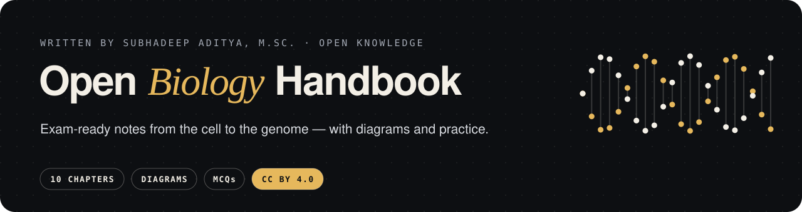
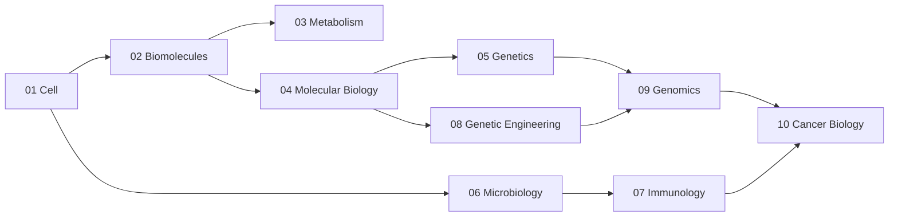

<a href="https://github.com/Subhadeep998/Open-Biology-Handbook">
  
</a>

<p align="center">
  <a href="https://github.com/Subhadeep998/Open-Biology-Handbook/stargazers"></a>
  
  
  <a href="LICENSE"></a>
</p>

<p align="center"><b>Free, exam-ready biology notes — from the cell to the cancer genome.</b><br>
<sub>Written for B.Sc./M.Sc. students, NEET · CUET · GAT-B · CSIR-NET · GATE aspirants, and anyone curious about life science.</sub></p>

---

## 📘 Chapters

| # | Chapter | You'll learn |
|:--|:--|:--|
| 01 | [**Cell Biology**](chapters/01-cell-biology.md) | Cell theory, organelles, membranes, cytoskeleton, cell cycle, mitosis vs meiosis |
| 02 | [**Biomolecules**](chapters/02-biomolecules.md) | Carbohydrates, lipids, proteins, nucleic acids, pH and buffers |
| 03 | [**Enzymes & Metabolism**](chapters/03-enzymes-metabolism.md) | Enzyme kinetics, inhibition, glycolysis → Krebs → ETC, photosynthesis |
| 04 | [**Molecular Biology**](chapters/04-molecular-biology.md) | Replication, transcription, translation, lac operon, mutation and repair |
| 05 | [**Genetics & Inheritance**](chapters/05-genetics.md) | Mendel and beyond, pedigrees, chromosomal disorders, Hardy–Weinberg |
| 06 | [**Microbiology**](chapters/06-microbiology.md) | Gram stain, growth, gene transfer, viruses, antibiotics and AMR |
| 07 | [**Immunology**](chapters/07-immunology.md) | Innate vs adaptive, MHC, antibodies, vaccines, hypersensitivity |
| 08 | [**Genetic Engineering**](chapters/08-genetic-engineering.md) | Cloning, PCR, blots, sequencing, CRISPR, biotech applications |
| 09 | [**Genomics & Bioinformatics**](chapters/09-genomics-bioinformatics.md) | -omics, NGS pipelines, BLAST, databases, precision medicine |
| 10 | [**Cancer Biology**](chapters/10-cancer-biology.md) | Hallmarks, oncogenes vs tumour suppressors, targeted and immunotherapy |

Each chapter has the same shape, so revision is fast:

```
In one line  →  core concepts  →  diagram  →  quick-revision tables
            →  ⚠️ common confusions  →  📝 5 MCQs with answers  →  📖 go deeper
```

## 🗺️ How the chapters connect



## 🎯 How to use this handbook

- **First pass:** read a chapter, then attempt the MCQs *without* looking.
- **Revision:** jump straight to the tables and the ⚠️ section — that's where marks are lost.
- **Going further:** every chapter ends with free, authoritative sources (OpenStax, NCBI Bookshelf, MIT OCW).
- **Want resources, tools and databases?** See the companion list → [**Awesome Biotechnology**](https://github.com/Subhadeep998/Awesome-Biotechnology).

## 🤝 Contributing

Found an error, or want to add a chapter (plant biology, ecology, human physiology, biostatistics…)? [Open an issue](../../issues) or a pull request. Accuracy matters more than length — please cite a reliable source for corrections.

---

<p align="center">
  <b>If these notes helped you,</b> ⭐ star the repo and 👤 <a href="https://github.com/Subhadeep998">follow @Subhadeep998</a> — new chapters are on the way.<br>
  <sub>Written by <a href="https://subhadeep998.github.io">Subhadeep Aditya</a>, M.Sc. Biotechnology · Kolkata, India · <a href="LICENSE">CC BY 4.0</a> — share freely with credit.</sub>
</p>
