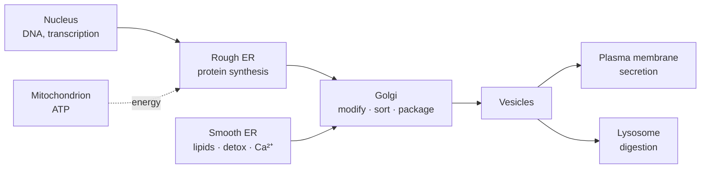
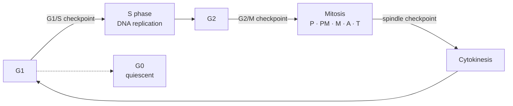

# 01 · Cell Biology

[← Contents](../README.md) · [Next: Biomolecules →](02-biomolecules.md)

> **In one line:** the cell is the smallest unit that can carry out all the processes of life — every topic in biology eventually comes back here.

## 1. Cell theory

1. All living organisms are made of one or more cells (Schleiden 1838, Schwann 1839).
2. The cell is the basic structural and functional unit of life.
3. All cells arise from pre-existing cells — *omnis cellula e cellula* (Virchow 1855).

## 2. Prokaryotes vs eukaryotes

| Feature | Prokaryote | Eukaryote |
|:--|:--|:--|
| Nucleus | Absent — DNA in a **nucleoid** | Membrane-bound nucleus |
| Typical size | 0.2–5 µm | 10–100 µm |
| Membrane organelles | None | ER, Golgi, mitochondria, lysosomes, etc. |
| Ribosomes | **70S** (50S + 30S) | **80S** (60S + 40S) in cytoplasm; 70S in mitochondria and chloroplasts |
| Chromosome | Usually single, circular | Multiple, linear, wound on histones |
| Cell division | Binary fission | Mitosis / meiosis |
| Examples | Bacteria, archaea | Animals, plants, fungi, protists |

## 3. Organelles at a glance

| Organelle | Main job | Remember it as |
|:--|:--|:--|
| Nucleus | Stores DNA; site of transcription; nucleolus makes rRNA | Control room |
| Rough ER | Synthesis of secretory and membrane proteins | Factory floor |
| Smooth ER | Lipid synthesis, detoxification, Ca²⁺ storage | Chemical plant |
| Golgi apparatus | Modifies (e.g. glycosylation), sorts and ships proteins | Post office |
| Lysosome | Hydrolytic enzymes at pH ≈ 4.5–5 | Recycling centre |
| Peroxisome | Breaks down fatty acids and H₂O₂ (catalase) | Detox unit |
| Mitochondrion | Aerobic respiration, ATP; has own DNA | Power plant |
| Chloroplast | Photosynthesis; has own DNA | Solar panel |
| Ribosome | Translation (mRNA → protein) | Assembly machine |
| Cytoskeleton | Shape, transport, division | Scaffolding and rails |
| Vacuole | Storage; turgor in plants | Warehouse |

**Endosymbiotic theory** — mitochondria and chloroplasts descend from engulfed free-living bacteria. Evidence: double membranes, their own circular DNA, 70S ribosomes, division by fission.

## 4. The plasma membrane

- **Fluid mosaic model** (Singer & Nicolson, 1972): a phospholipid bilayer with proteins floating in it.
- Cholesterol buffers fluidity in animal cells.
- Transport:

| Type | Energy? | Gradient | Example |
|:--|:--|:--|:--|
| Simple diffusion | No | Down | O₂, CO₂ |
| Facilitated diffusion | No | Down | Glucose via GLUT |
| Osmosis | No | Water moves toward higher solute | Aquaporins |
| Primary active transport | ATP | Against | Na⁺/K⁺-ATPase (3 Na⁺ out, 2 K⁺ in) |
| Secondary active transport | Uses an ion gradient | Against | SGLT1 (Na⁺–glucose symport) |
| Endocytosis / exocytosis | ATP | Bulk | Phagocytosis, hormone secretion |

## 5. Cytoskeleton

| Filament | Protein | Diameter | Roles |
|:--|:--|:--|:--|
| Microfilaments | Actin | ~7 nm | Cell shape, muscle contraction (with myosin), cytokinesis |
| Intermediate filaments | Keratin, vimentin, lamins | ~10 nm | Mechanical strength |
| Microtubules | α/β-tubulin | ~25 nm | Spindle, cilia/flagella (9+2), transport (kinesin, dynein) |

## 6. The cell cycle

- **Interphase** = G1 + S + G2 (most of the cycle).
- **Mitosis:** prophase → prometaphase → metaphase → anaphase → telophase. Result: 2 identical diploid cells.
- **Meiosis:** two divisions → 4 haploid cells; crossing over in prophase I; homologues separate in anaphase I, sister chromatids in anaphase II.
- **Regulators:** cyclins + cyclin-dependent kinases (CDKs); **p53** halts the cycle after DNA damage; **Rb** guards the G1/S transition.

## 7. Mitosis vs meiosis

| | Mitosis | Meiosis |
|:--|:--|:--|
| Divisions | 1 | 2 |
| Daughter cells | 2, diploid (2n) | 4, haploid (n) |
| Genetically identical? | Yes | No |
| Crossing over | No | Yes (prophase I) |
| Purpose | Growth, repair | Gametes, variation |

## 8. Cell death

- **Apoptosis** — programmed, tidy: caspases, DNA laddering, membrane blebbing, no inflammation.
- **Necrosis** — accidental, messy: cell swelling and rupture, inflammation.

## ⚠️ Common confusions

- *Chromatid vs chromosome:* after S phase one chromosome = two sister chromatids joined at the centromere.
- *70S ≠ 50S + 30S arithmetic:* Svedberg units measure sedimentation, so they don't add up.
- *Plant cells have no centrioles* yet still form spindles.

## 📝 Practice

1. Which organelle is the main site of lipid synthesis?
   (a) RER (b) SER (c) Golgi (d) Lysosome
2. The Na⁺/K⁺ pump moves:
   (a) 2 Na⁺ out, 3 K⁺ in (b) 3 Na⁺ out, 2 K⁺ in (c) 3 Na⁺ in, 2 K⁺ out (d) 1 Na⁺ out, 1 K⁺ in
3. Crossing over occurs during:
   (a) Prophase of mitosis (b) Anaphase I (c) Prophase I (d) Telophase II
4. Which is NOT evidence for endosymbiosis?
   (a) Circular DNA (b) 70S ribosomes (c) Double membrane (d) Presence of histone-wrapped linear chromosomes
5. Microtubules are made of:
   (a) Actin (b) Keratin (c) Tubulin (d) Myosin

<b>Answers</b>

1 (b) · 2 (b) · 3 (c) · 4 (d) · 5 (c)

## 📖 Go deeper

- [OpenStax Biology 2e — Unit 2: The Cell](https://openstax.org/books/biology-2e/pages/4-introduction)
- [*Molecular Biology of the Cell*, 4th ed. (NCBI Bookshelf)](https://www.ncbi.nlm.nih.gov/books/NBK21054/)
- [iBiology — Cell Biology talks](https://www.ibiology.org/cell-biology/)
