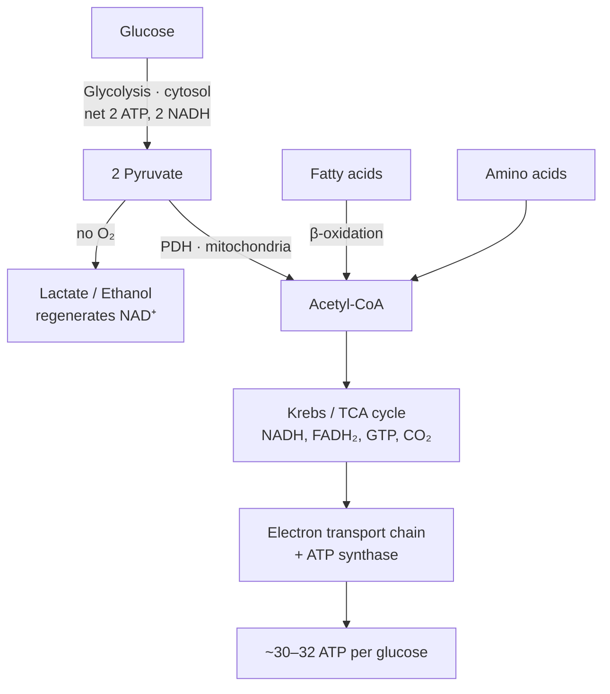

# 03 · Enzymes & Metabolism

[← Biomolecules](02-biomolecules.md) · [Contents](../README.md) · [Next: Molecular Biology →](04-molecular-biology.md)

> **In one line:** enzymes lower activation energy so the reactions of life happen fast enough; metabolism is the network those reactions form.

## 1. How enzymes work

- Biological catalysts — mostly proteins (ribozymes are catalytic RNA).
- Lower **activation energy**; do **not** change ΔG or the equilibrium.
- **Lock-and-key** (Fischer) → refined to **induced fit** (Koshland).
- **Cofactors:** inorganic ions (Mg²⁺, Zn²⁺) or organic **coenzymes** (NAD⁺, FAD, CoA — often from vitamins).
- **Apoenzyme + cofactor = holoenzyme.**

## 2. Enzyme classes (EC numbers)

| EC | Class | Reaction | Example |
|:--|:--|:--|:--|
| 1 | Oxidoreductases | Redox | Lactate dehydrogenase |
| 2 | Transferases | Move a group | Hexokinase |
| 3 | Hydrolases | Hydrolysis | Lipase, proteases |
| 4 | Lyases | Break bonds without water/redox | Aldolase |
| 5 | Isomerases | Rearrange | Phosphoglucose isomerase |
| 6 | Ligases | Join using ATP | DNA ligase |
| 7 | Translocases | Move molecules across membranes | ATP synthase |

Memory aid: **"Over The HILL T"**.

## 3. Michaelis–Menten kinetics

**v = Vmax [S] / (Km + [S])**

- **Km** = [S] at half Vmax → lower Km means higher affinity.
- **Lineweaver–Burk** (double reciprocal): 1/v vs 1/[S]; y-intercept = 1/Vmax, x-intercept = −1/Km.

| Inhibition | Binds | Km | Vmax | Overcome by more substrate? |
|:--|:--|:--|:--|:--|
| Competitive | Active site | ↑ | Same | Yes |
| Non-competitive | Elsewhere (E or ES equally) | Same | ↓ | No |
| Uncompetitive | ES complex only | ↓ | ↓ | No |

**Allosteric enzymes** give sigmoidal curves (e.g. phosphofructokinase-1).

## 4. Metabolism map

## 5. Key numbers per glucose (aerobic)

| Stage | Location | ATP (net, direct) | NADH | FADH₂ |
|:--|:--|:--|:--|:--|
| Glycolysis | Cytosol | 2 | 2 | 0 |
| Pyruvate → acetyl-CoA (×2) | Mito matrix | 0 | 2 | 0 |
| Krebs cycle (×2) | Mito matrix | 2 (as GTP/ATP) | 6 | 2 |
| Oxidative phosphorylation | Inner membrane | ~26–28 | — | — |
| **Total** | | **~30–32** | | |

Older textbooks say 36–38; the modern figure uses ~2.5 ATP/NADH and ~1.5 ATP/FADH₂.

- **Rate-limiting enzymes:** glycolysis → PFK-1 · Krebs → isocitrate dehydrogenase · gluconeogenesis → fructose-1,6-bisphosphatase · cholesterol synthesis → HMG-CoA reductase (statin target).
- **ETC:** complexes I–IV pump protons; O₂ is the final electron acceptor; **chemiosmosis** (Mitchell) drives ATP synthase.

## 6. Photosynthesis in brief

- **Light reactions** (thylakoid): water split, O₂ released, ATP + NADPH made (PSII → PSI).
- **Calvin cycle** (stroma): CO₂ fixed by **RuBisCO** → G3P → sugars.
- C₄ and CAM plants concentrate CO₂ to limit photorespiration.

## ⚠️ Common confusions

- Enzymes speed up reactions; they don't make unfavourable reactions favourable.
- Glycolysis doesn't need O₂ — what needs O₂ is regenerating NAD⁺ via the ETC.
- Km is a constant for an enzyme–substrate pair, not a concentration you set.

## 📝 Practice

1. A competitive inhibitor: (a) lowers Vmax (b) raises Km (c) lowers Km (d) binds only ES
2. The final electron acceptor in aerobic respiration is: (a) NAD⁺ (b) FAD (c) O₂ (d) CO₂
3. Statins inhibit: (a) PFK-1 (b) HMG-CoA reductase (c) RuBisCO (d) ATP synthase
4. Where does the Krebs cycle occur in eukaryotes? (a) Cytosol (b) Inner membrane (c) Mitochondrial matrix (d) Stroma
5. DNA ligase belongs to EC class: (a) 2 (b) 3 (c) 5 (d) 6

<b>Answers</b>

1 (b) · 2 (c) · 3 (b) · 4 (c) · 5 (d)

## 📖 Go deeper

- [*Biochemistry*, Berg et al., 5th ed. (NCBI Bookshelf)](https://www.ncbi.nlm.nih.gov/books/NBK21154/)
- [KEGG Pathway maps](https://www.genome.jp/kegg/pathway.html)
- [Khan Academy — Cellular respiration](https://www.khanacademy.org/science/biology/cellular-respiration-and-fermentation)
