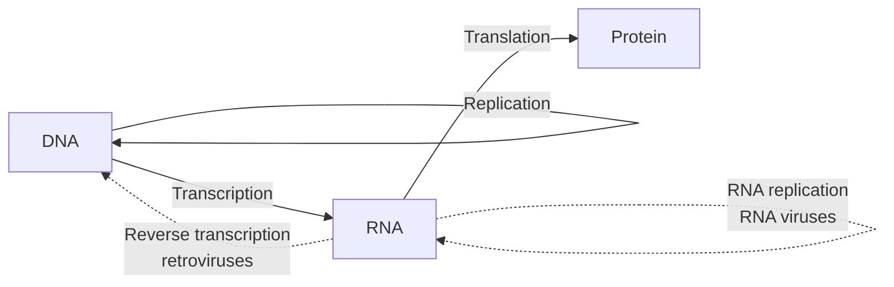
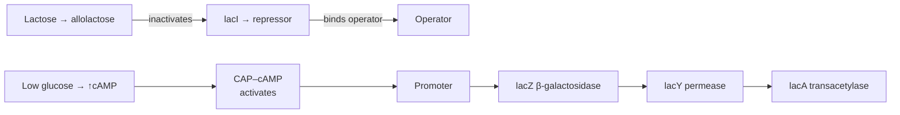

# 04 · Molecular Biology

[← Enzymes & Metabolism](03-enzymes-metabolism.md) · [Contents](../README.md) · [Next: Genetics →](05-genetics.md)

> **In one line:** information flows DNA → RNA → protein, and nearly every step is checked, regulated and occasionally broken.

## 1. The central dogma

## 2. DNA replication

- **Semi-conservative** — proven by Meselson & Stahl (1958) with ¹⁵N/¹⁴N.
- Always synthesised **5′ → 3′**; **leading strand** continuous, **lagging strand** in **Okazaki fragments**.

| Enzyme | Job |
|:--|:--|
| Helicase | Unwinds the double helix |
| Single-strand binding proteins | Keep strands apart |
| Topoisomerase (gyrase in bacteria) | Relieves supercoiling |
| Primase | Lays RNA primers |
| DNA polymerase III (prokaryotes) / δ and ε (eukaryotes) | Main synthesis, with 3′→5′ proofreading |
| DNA polymerase I (prokaryotes) | Removes primers, fills gaps |
| DNA ligase | Seals nicks |
| Telomerase | Extends chromosome ends (a reverse transcriptase) |

## 3. Transcription

| | Prokaryotes | Eukaryotes |
|:--|:--|:--|
| RNA polymerase | One (σ factor recognises promoter) | Pol I (rRNA), **Pol II (mRNA)**, Pol III (tRNA, 5S rRNA) |
| Promoter | −10 (Pribnow, TATAAT), −35 | TATA box (~−25 to −30), enhancers |
| Processing | None — translation is coupled | 5′ cap, 3′ poly-A tail, **splicing** of introns |
| Location | Cytoplasm | Nucleus |

- **Template (antisense) strand** is read 3′→5′; mRNA matches the **coding (sense) strand** with U for T.
- **Alternative splicing** lets one gene make many proteins.

## 4. Translation

- **Genetic code:** triplet, non-overlapping, degenerate (61 sense codons for 20 amino acids), nearly universal.
- **Start:** AUG (Met; fMet in bacteria). **Stop:** UAA, UAG, UGA.
- **Wobble** at the third codon position lets one tRNA read several codons.
- Ribosome sites: **A** (aminoacyl) · **P** (peptidyl) · **E** (exit).
- Aminoacyl-tRNA synthetases match each amino acid to its tRNA — the real "translators".

## 5. Gene regulation

**Lac operon (E. coli)** — an inducible, negatively controlled system

- **Trp operon** — repressible; tryptophan acts as co-repressor; attenuation fine-tunes it.
- **Eukaryotes:** transcription factors, enhancers/silencers, **chromatin** (histone acetylation opens, deacetylation closes), **DNA methylation** at CpG silences, and **miRNAs** silence after transcription.

## 6. Mutation and repair

| Mutation | Effect |
|:--|:--|
| Silent | Same amino acid |
| Missense | Different amino acid (e.g. sickle cell: Glu→Val in β-globin) |
| Nonsense | Premature stop codon |
| Frameshift | Insertion/deletion not in multiples of 3 |

| Repair system | Fixes | Disease when broken |
|:--|:--|:--|
| Mismatch repair | Replication mismatches | Lynch syndrome |
| Nucleotide excision repair | Bulky lesions, UV thymine dimers | Xeroderma pigmentosum |
| Base excision repair | Damaged single bases | — |
| Homologous recombination | Double-strand breaks (error-free) | BRCA1/2 cancers |
| Non-homologous end joining | Double-strand breaks (error-prone) | — |

## ⚠️ Common confusions

- Polymerases can't start from scratch — they need a 3′-OH (primer). RNA polymerases don't.
- The *coding* strand is not the one read by RNA polymerase.
- "Gene expression" includes RNA processing, translation and protein stability — not only transcription.

## 📝 Practice

1. Meselson–Stahl showed replication is: (a) conservative (b) dispersive (c) semi-conservative (d) random
2. Okazaki fragments occur on the: (a) leading strand (b) lagging strand (c) both (d) mRNA
3. Eukaryotic mRNA is made by: (a) Pol I (b) Pol II (c) Pol III (d) Primase
4. Which is a stop codon? (a) AUG (b) UGG (c) UAG (d) GUA
5. In the lac operon, high glucose leads to: (a) high cAMP (b) low cAMP, low expression (c) repressor inactivation (d) maximal expression

<b>Answers</b>

1 (c) · 2 (b) · 3 (b) · 4 (c) · 5 (b)

## 📖 Go deeper

- [*Molecular Cell Biology*, 4th ed. (NCBI Bookshelf)](https://www.ncbi.nlm.nih.gov/books/NBK21475/)
- [DNA Learning Center — 3D animations](https://dnalc.cshl.edu/resources/3d/)
- [MIT OpenCourseWare — Biology courses](https://ocw.mit.edu/search/?d=Biology)
