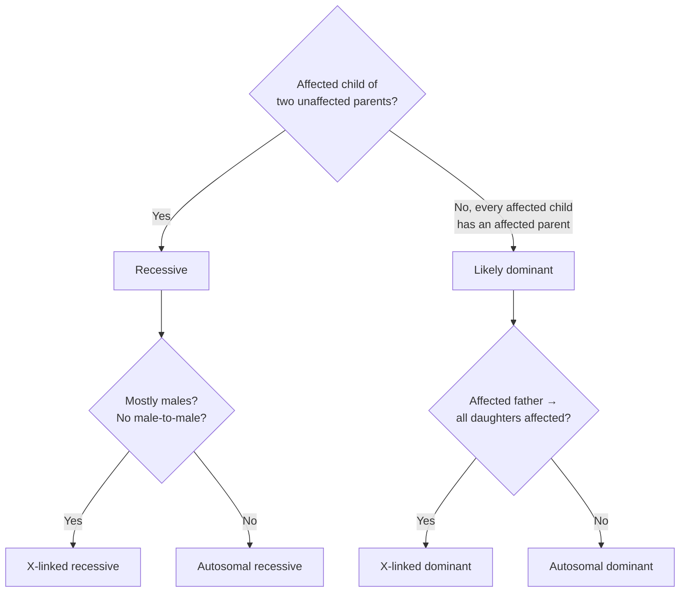

# 05 · Genetics & Inheritance

[← Molecular Biology](04-molecular-biology.md) · [Contents](../README.md) · [Next: Microbiology →](06-microbiology.md)

> **In one line:** genetics explains how traits pass from parents to offspring — and why they sometimes don't follow the simple rules.

## 1. Mendel's laws

1. **Dominance** — in a heterozygote one allele masks the other.
2. **Segregation** — the two alleles of a gene separate into different gametes.
3. **Independent assortment** — genes on different chromosomes (or far apart) assort independently.

| Cross | Phenotypic ratio | Genotypic ratio |
|:--|:--|:--|
| Monohybrid (Aa × Aa) | 3 : 1 | 1 : 2 : 1 |
| Dihybrid (AaBb × AaBb) | 9 : 3 : 3 : 1 | — |
| Test cross (Aa × aa) | 1 : 1 | 1 : 1 |
| Dihybrid test cross | 1 : 1 : 1 : 1 | — |

## 2. Beyond Mendel

| Pattern | What happens | Example | F2 ratio |
|:--|:--|:--|:--|
| Incomplete dominance | Blend | Snapdragon (red × white → pink) | 1 : 2 : 1 |
| Co-dominance | Both expressed | ABO blood group (I^A I^B), MN blood group | 1 : 2 : 1 |
| Multiple alleles | >2 alleles in population | ABO (I^A, I^B, i) | — |
| Pleiotropy | One gene, many traits | Phenylketonuria, Marfan syndrome | — |
| Epistasis | One gene masks another | Coat colour in mice/Labradors | 9 : 3 : 4 (recessive) · 12 : 3 : 1 (dominant) |
| Polygenic | Many genes add up | Height, skin colour | Continuous |
| Linkage | Genes close together inherited together | Morgan's *Drosophila* | Deviates from 9:3:3:1 |

**Recombination frequency (%) = recombinants ÷ total offspring × 100** → 1% = 1 centiMorgan (cM).

## 3. Sex determination and sex-linked inheritance

- Humans: XX female, XY male; **SRY** on Y triggers male development.
- Birds: ZW female, ZZ male. Grasshoppers: XO.
- **X-linked recessive** (haemophilia A, red-green colour blindness, Duchenne muscular dystrophy): more males affected; no father-to-son transmission; carrier mothers pass it to half their sons.

## 4. Reading pedigrees

| Mode | Examples |
|:--|:--|
| Autosomal dominant | Huntington's disease, achondroplasia, familial hypercholesterolaemia |
| Autosomal recessive | Cystic fibrosis, sickle-cell disease, thalassaemia, PKU |
| X-linked recessive | Haemophilia A/B, DMD, G6PD deficiency |
| Mitochondrial | Maternal only — LHON, MELAS |

## 5. Chromosomal disorders

| Condition | Karyotype |
|:--|:--|
| Down syndrome | Trisomy 21 (47, +21) |
| Edwards syndrome | Trisomy 18 |
| Patau syndrome | Trisomy 13 |
| Turner syndrome | 45, X |
| Klinefelter syndrome | 47, XXY |

Most aneuploidy comes from **non-disjunction** in meiosis.

## 6. Population genetics

**Hardy–Weinberg:** p + q = 1 and **p² + 2pq + q² = 1**

Holds when there is no mutation, no migration, no selection, random mating and a very large population.

*Worked example:* 1 in 2,500 newborns has cystic fibrosis → q² = 1/2500 → q = 0.02 → p = 0.98 → carriers 2pq ≈ 0.039 ≈ **1 in 25**.

**Forces of change:** mutation, natural selection, genetic drift (founder and bottleneck effects), gene flow, non-random mating.

## ⚠️ Common confusions

- "Dominant" ≠ "common": polydactyly is dominant but rare.
- Linkage lowers recombination; it doesn't prevent it.
- Hardy–Weinberg describes the *absence* of evolution — a baseline, not reality.

## 📝 Practice

1. AaBb × aabb gives a phenotypic ratio of: (a) 9:3:3:1 (b) 1:1:1:1 (c) 3:1 (d) 1:2:1
2. ABO blood group shows: (a) incomplete dominance (b) co-dominance and multiple alleles (c) epistasis (d) linkage
3. A trait passed from an affected father to all his daughters but none of his sons is: (a) AD (b) AR (c) X-linked dominant (d) Y-linked
4. If q² = 0.04, the carrier frequency 2pq is: (a) 0.16 (b) 0.32 (c) 0.64 (d) 0.04
5. Klinefelter syndrome is: (a) 45,X (b) 47,XXY (c) 47,+21 (d) 47,XYY

<b>Answers</b>

1 (b) · 2 (b) · 3 (c) · 4 (b) — q = 0.2, p = 0.8, 2pq = 0.32 · 5 (b)

## 📖 Go deeper

- [OpenStax Biology 2e — Genetics](https://openstax.org/books/biology-2e/pages/12-introduction)
- [OMIM — Online Mendelian Inheritance in Man](https://www.omim.org)
- [Coursera — Introduction to Genetics and Evolution (Duke)](https://www.coursera.org/learn/genetics-evolution)
