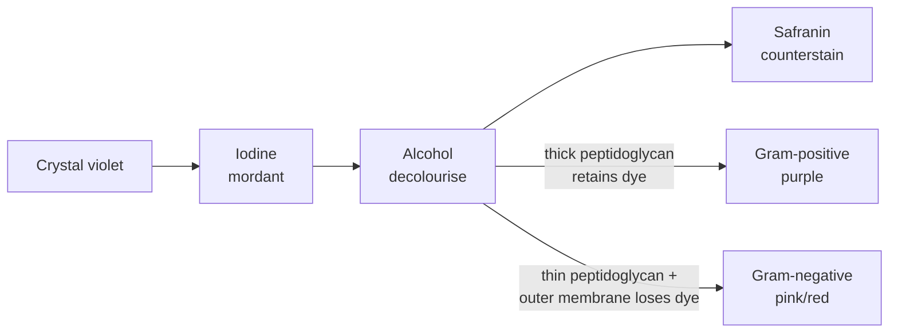

# 06 · Microbiology

[← Genetics](05-genetics.md) · [Contents](../README.md) · [Next: Immunology →](07-immunology.md)

> **In one line:** microbes are the planet's oldest, most numerous and most versatile life forms — and both our biggest threats and best tools.

## 1. The microbial world

| Group | Cell type | Size | Examples |
|:--|:--|:--|:--|
| Bacteria | Prokaryote | 0.5–5 µm | *E. coli*, *Staphylococcus*, *Mycobacterium* |
| Archaea | Prokaryote (ether-linked lipids) | 0.5–5 µm | Methanogens, halophiles |
| Fungi | Eukaryote (chitin wall) | 2 µm – macroscopic | Yeast, *Aspergillus*, *Candida* |
| Protozoa | Eukaryote | 10–200 µm | *Plasmodium*, *Entamoeba* |
| Viruses | Acellular | 20–300 nm | Influenza, HIV, SARS-CoV-2, bacteriophages |

**Milestones:** Leeuwenhoek (first microscope observations) · Pasteur (disproved spontaneous generation; pasteurisation) · Koch (postulates; *M. tuberculosis*) · Fleming (penicillin, 1928) · Lister (antiseptic surgery).

## 2. Gram staining

| | Gram-positive | Gram-negative |
|:--|:--|:--|
| Peptidoglycan | Thick (20–80 nm) | Thin (~2–7 nm) |
| Outer membrane | No | Yes, with **LPS (endotoxin)** |
| Teichoic acids | Yes | No |
| Examples | *Staphylococcus, Streptococcus, Bacillus, Clostridium* | *E. coli, Salmonella, Pseudomonas, Vibrio* |

*Mycobacterium* has mycolic acid walls → **acid-fast** (Ziehl–Neelsen) stain.

## 3. Bacterial growth

**Growth curve:** lag → log (exponential) → stationary → death.

- Generation time g = t / n, where n = number of generations; N = N₀ × 2ⁿ.
- *E. coli* in rich media divides roughly every 20 minutes.

| Oxygen need | Example |
|:--|:--|
| Obligate aerobe | *Mycobacterium tuberculosis* |
| Obligate anaerobe | *Clostridium* |
| Facultative anaerobe | *E. coli*, yeast |
| Microaerophile | *Helicobacter pylori*, *Campylobacter* |

## 4. Bacterial genetics — how genes move sideways

| Mechanism | What moves | Via |
|:--|:--|:--|
| **Transformation** | Free DNA | Uptake by competent cells (Griffith 1928; Avery–MacLeod–McCarty 1944) |
| **Transduction** | DNA | Bacteriophage |
| **Conjugation** | Plasmid (e.g. F factor, R plasmids) | Sex pilus, cell-to-cell contact |
| Transposition | Transposons | "Jumping genes" within/between genomes |

Horizontal gene transfer is a major route for spreading antibiotic resistance.

## 5. Viruses

- Genome: DNA *or* RNA, single- or double-stranded; protein **capsid**; some have an **envelope**.
- **Lytic cycle:** attach → inject → replicate → assemble → lyse.
- **Lysogenic cycle:** phage DNA integrates as a **prophage**, copied with the host.
- **Baltimore classification:** seven groups by genome type and how mRNA is made (e.g. Group VI retroviruses such as HIV use reverse transcriptase).

## 6. Antibiotics and resistance

| Target | Antibiotic class |
|:--|:--|
| Cell wall synthesis | β-lactams (penicillins, cephalosporins), vancomycin |
| 30S ribosome | Aminoglycosides, tetracyclines |
| 50S ribosome | Macrolides, chloramphenicol, linezolid |
| DNA gyrase | Fluoroquinolones |
| Folate synthesis | Sulphonamides, trimethoprim |
| RNA polymerase | Rifampicin |

**Resistance mechanisms:** enzymatic breakdown (β-lactamases), altered target (MRSA's PBP2a), efflux pumps, reduced permeability. AMR is a WHO top-ten global public-health threat.

## 7. Useful microbes

Fermentation (curd, bread, idli, beer) · antibiotics (*Penicillium*, *Streptomyces*) · recombinant insulin (*E. coli*, yeast) · biofertilisers (*Rhizobium*, *Azotobacter*) · bioremediation · biogas (methanogens) · **quorum sensing** research for anti-virulence drugs.

## ⚠️ Common confusions

- Antibiotics don't work on viruses.
- Endotoxin (LPS, Gram-negative wall) ≠ exotoxin (secreted protein, e.g. cholera or tetanus toxin).
- Archaea are not bacteria — they are a separate domain, closer to eukaryotes in some machinery.

## 📝 Practice

1. Gram-negative bacteria appear: (a) purple (b) pink/red (c) green (d) unstained
2. Gene transfer via bacteriophage is: (a) transformation (b) transduction (c) conjugation (d) transposition
3. Penicillin acts on: (a) 30S ribosome (b) cell wall synthesis (c) DNA gyrase (d) folate synthesis
4. Starting from 100 cells with a 20-min generation time, how many cells after 1 hour? (a) 300 (b) 600 (c) 800 (d) 1,600
5. Ziehl–Neelsen staining identifies: (a) Gram-positives (b) Acid-fast bacteria (c) Fungi (d) Spores only

<b>Answers</b>

1 (b) · 2 (b) · 3 (b) · 4 (c) — 3 generations: 100 × 2³ = 800 · 5 (b)

## 📖 Go deeper

- [OpenStax Microbiology](https://openstax.org/details/books/microbiology)
- [WHO — Antimicrobial resistance](https://www.who.int/health-topics/antimicrobial-resistance)
- [American Society for Microbiology](https://asm.org)
