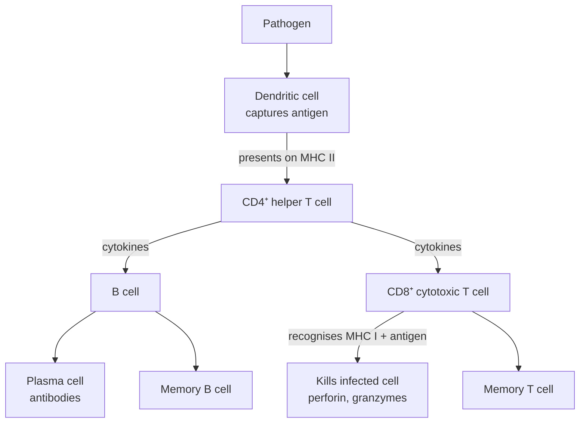

# 07 · Immunology

[← Microbiology](06-microbiology.md) · [Contents](../README.md) · [Next: Genetic Engineering →](08-genetic-engineering.md)

> **In one line:** the immune system tells self from non-self — fast and broad with innate immunity, slow but precise and memorable with adaptive immunity.

## 1. Two arms of immunity

| | Innate | Adaptive |
|:--|:--|:--|
| Speed | Minutes–hours | Days (first time); faster on re-exposure |
| Specificity | Patterns (PAMPs via **TLRs**) | Specific antigens (epitopes) |
| Memory | Essentially none* | Yes |
| Cells | Neutrophils, macrophages, dendritic cells, NK cells, mast cells, eosinophils | B cells, T cells |
| Molecules | Complement, interferons, cytokines, acute-phase proteins | Antibodies, T-cell receptors |

*"Trained immunity" — a limited innate memory — is an active research area.

## 2. How an adaptive response unfolds

- **MHC I** — on all nucleated cells → presents to **CD8⁺** T cells.
- **MHC II** — on antigen-presenting cells (dendritic cells, macrophages, B cells) → presents to **CD4⁺** T cells.
- Rule of 8: **CD4 × MHC II = 8**, **CD8 × MHC I = 8**.

## 3. Antibodies

Y-shaped: 2 heavy + 2 light chains; **Fab** binds antigen, **Fc** recruits effectors.

| Class | Key feature |
|:--|:--|
| **IgG** | Most abundant in serum; crosses the placenta; secondary response |
| **IgM** | Pentamer; first made in a primary response; best at activating complement |
| **IgA** | Dimer in secretions — tears, saliva, breast milk |
| **IgE** | Allergy and anti-parasite; binds mast cells |
| **IgD** | B-cell receptor on naive B cells |

**Diversity** comes from V(D)J recombination (RAG1/RAG2), junctional diversity, somatic hypermutation and class switching.

## 4. Primary vs secondary response

| | Primary | Secondary |
|:--|:--|:--|
| Lag | ~5–10 days | 1–3 days |
| Main antibody | IgM | IgG |
| Magnitude | Lower | Much higher |
| Affinity | Lower | Higher (affinity maturation) |

This is why vaccines and booster doses work.

## 5. Immunity types

| | Natural | Artificial |
|:--|:--|:--|
| **Active** | Infection | Vaccination |
| **Passive** | Maternal IgG (placenta), IgA (milk) | Antivenom, monoclonal antibodies, immunoglobulin |

**Vaccine platforms:** live-attenuated (MMR, BCG, oral polio) · inactivated (IPV, rabies) · subunit/recombinant (hepatitis B, HPV) · toxoid (tetanus, diphtheria) · conjugate (Hib, pneumococcal) · viral vector · **mRNA** (COVID-19).

## 6. Hypersensitivity (Gell & Coombs)

| Type | Mechanism | Example |
|:--|:--|:--|
| I — Immediate | IgE, mast cells, histamine | Hay fever, anaphylaxis, asthma |
| II — Cytotoxic | IgG/IgM against cell-surface antigens | Transfusion reactions, Rh disease |
| III — Immune complex | Antigen–antibody complexes deposit | SLE, serum sickness |
| IV — Delayed | T cells | Tuberculin test, contact dermatitis |

Memory aid: **ACID** — Anaphylactic, Cytotoxic, Immune complex, Delayed.

## 7. When immunity goes wrong — and how we harness it

- **Autoimmunity:** type 1 diabetes, rheumatoid arthritis, multiple sclerosis.
- **Immunodeficiency:** SCID (primary); HIV/AIDS destroys CD4⁺ T cells (secondary).
- **Immunotherapy:** monoclonal antibodies (hybridoma technology — Köhler & Milstein), checkpoint inhibitors (anti-PD-1, anti-CTLA-4), **CAR-T cells**.

## ⚠️ Common confusions

- Antigen ≠ antibody: antigen is what gets recognised; antibody does the recognising.
- Plasma cells secrete antibodies; they don't present antigen.
- Passive immunity is immediate but short-lived — no memory is made.

## 📝 Practice

1. Which antibody crosses the placenta? (a) IgA (b) IgM (c) IgG (d) IgE
2. CD8⁺ T cells recognise antigen on: (a) MHC I (b) MHC II (c) both (d) neither
3. Tuberculin skin test is which hypersensitivity? (a) I (b) II (c) III (d) IV
4. The first antibody made in a primary response is: (a) IgG (b) IgM (c) IgA (d) IgD
5. Antivenom gives: (a) natural active (b) artificial active (c) natural passive (d) artificial passive immunity

<b>Answers</b>

1 (c) · 2 (a) · 3 (d) · 4 (b) · 5 (d)

## 📖 Go deeper

- [*Immunobiology*, Janeway, 5th ed. (NCBI Bookshelf)](https://www.ncbi.nlm.nih.gov/books/NBK10757/)
- [British Society for Immunology — Bitesized Immunology](https://www.immunology.org/public-information/bitesized-immunology)
- [Khan Academy — Immunology](https://www.khanacademy.org/science/biology/human-biology/immunology)
