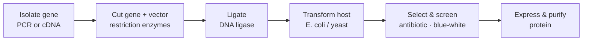
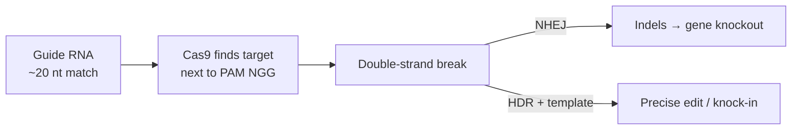

# 08 · Genetic Engineering & Biotechnology Tools

[← Immunology](07-immunology.md) · [Contents](../README.md) · [Next: Genomics & Bioinformatics →](09-genomics-bioinformatics.md)

> **In one line:** cut, copy, paste and edit DNA — the toolkit behind recombinant medicines, GM crops, diagnostics and gene therapy.

## 1. Recombinant DNA workflow

**Restriction enzymes** (type II) cut at palindromic sites: *EcoRI* G^AATTC (sticky ends) · *SmaI* CCC^GGG (blunt ends). Named genus–species–strain–order: **E**scherichia **co**li **R**Y13 **I**.

**Vectors**

| Vector | Insert size |
|:--|:--|
| Plasmid (e.g. pUC19, pBR322) | up to ~10 kb |
| Bacteriophage λ | ~ up to 23 kb |
| Cosmid | ~ up to 45 kb |
| BAC | ~100–300 kb |
| YAC | ~100 kb – 2 Mb |

A good vector has an **ori**, a **selectable marker** (e.g. *amp*ᴿ) and a **multiple cloning site**. **Blue-white screening:** insert disrupts *lacZα* → white colonies = recombinant.

## 2. PCR — the photocopier for DNA

| Step | Temperature | What happens |
|:--|:--|:--|
| Denaturation | ~94–98 °C | Strands separate |
| Annealing | ~50–65 °C | Primers bind |
| Extension | 72 °C | *Taq* polymerase copies |

After *n* cycles: up to **2ⁿ** copies. Variants: **RT-PCR** (RNA → cDNA), **qPCR** (real-time quantification), digital PCR, multiplex PCR. Inventor: Kary Mullis (Nobel 1993).

## 3. Separating and detecting

| Technique | Detects |
|:--|:--|
| Agarose gel electrophoresis | DNA by size (DNA is negative → moves to +) |
| SDS-PAGE | Proteins by size |
| **Southern** blot | DNA |
| **Northern** blot | RNA |
| **Western** blot | Protein (antibody probe) |
| ELISA | Antigen or antibody, in plates |
| Flow cytometry | Cell populations by fluorescent markers |

Memory aid: **SNoW DRoP** — Southern-DNA, Northern-RNA, Western-Protein.

## 4. Sequencing

- **Sanger** (chain termination with ddNTPs) — accurate, ~800–1,000 bp reads; still the gold standard for confirming clones.
- **Next-generation (short-read)** — e.g. Illumina sequencing-by-synthesis; massively parallel.
- **Long-read** — PacBio HiFi, Oxford Nanopore; resolve repeats and structural variants.

## 5. CRISPR–Cas9 genome editing

- Origin: a bacterial adaptive immune system against phages.
- Doudna & Charpentier — Nobel Prize in Chemistry 2020.
- Newer tools: **base editors** (single-letter changes without a double-strand break), **prime editors**, Cas12/Cas13 (diagnostics such as SHERLOCK/DETECTR).
- First approved CRISPR therapy: **Casgevy** (exa-cel) for sickle-cell disease and β-thalassaemia (UK and US approvals, 2023).

## 6. Applications

| Field | Example |
|:--|:--|
| Medicine | Recombinant insulin (1982), growth hormone, vaccines (hepatitis B), monoclonal antibodies, gene therapy |
| Agriculture | Bt cotton (Cry toxins from *Bacillus thuringiensis*), Golden Rice (β-carotene), herbicide tolerance |
| Diagnostics | PCR tests, ELISA, CRISPR-based detection |
| Industry | Enzymes for detergents, biofuels, bioplastics |
| Environment | Bioremediation, biosensors |
| Forensics | DNA fingerprinting with STRs |

**Biosafety and regulation in India:** GEAC (MoEFCC) approves environmental release of GMOs; RCGM (DBT) oversees research; IBSCs at institutions.

## ⚠️ Common confusions

- *Taq* is used because it survives denaturation temperatures, not because it's faster.
- cDNA has no introns — that's why it's used to express eukaryotic genes in bacteria.
- Cas9 needs a PAM next to the target; the PAM is in the genome, not in the guide.

## 📝 Practice

1. Which blot detects RNA? (a) Southern (b) Northern (c) Western (d) Eastern
2. After 10 PCR cycles from one template, the theoretical maximum is about: (a) 20 (b) 100 (c) 1,024 (d) 10,000
3. In blue-white screening, recombinant colonies are: (a) blue (b) white (c) red (d) none grow
4. The PAM for SpCas9 is: (a) TATA (b) NGG (c) AUG (d) GAATTC
5. Bt cotton expresses proteins from: (a) *Agrobacterium* (b) *Bacillus thuringiensis* (c) *E. coli* (d) *Rhizobium*

<b>Answers</b>

1 (b) · 2 (c) · 3 (b) · 4 (b) · 5 (b)

## 📖 Go deeper

- [Addgene — Molecular biology reference](https://www.addgene.org/mol-bio-reference/)
- [Addgene — CRISPR guide](https://www.addgene.org/guides/crispr/)
- [NEB — PCR resources](https://www.neb.com/en/applications/dna-amplification-pcr-and-qpcr)
