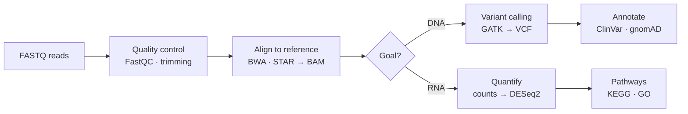

# 09 · Genomics & Bioinformatics

[← Genetic Engineering](08-genetic-engineering.md) · [Contents](../README.md) · [Next: Cancer Biology →](10-cancer-biology.md)

> **In one line:** genomics reads whole genomes; bioinformatics turns those billions of letters into biological meaning.

## 1. Landmarks

| Year | Milestone |
|:--|:--|
| 1977 | Sanger sequencing; first DNA genome (phage φX174) |
| 1995 | First bacterial genome (*Haemophilus influenzae*) |
| 2003 | Human Genome Project completed (~3.1 Gb, ~20,000 protein-coding genes) |
| 2005+ | Next-generation sequencing makes genomes routine |
| 2020 | AlphaFold 2 solves protein-structure prediction at CASP14 |
| 2022 | Telomere-to-Telomere (T2T) gapless human genome |
| 2023 | First human pangenome draft (47 individuals) |
| 2025 | GenomeIndia releases data from 10,000 Indian genomes |

## 2. The -omics family

| Field | Studies | Typical method |
|:--|:--|:--|
| Genomics | DNA | WGS, WES, arrays |
| Epigenomics | DNA methylation, histone marks | Bisulphite-seq, ChIP-seq, ATAC-seq |
| Transcriptomics | RNA | RNA-seq, single-cell RNA-seq |
| Proteomics | Proteins | Mass spectrometry |
| Metabolomics | Small molecules | MS, NMR |
| Metagenomics | Microbial communities | 16S rRNA, shotgun sequencing |

## 3. A typical NGS pipeline

**File formats to know:** FASTA (sequence) · FASTQ (sequence + quality) · SAM/BAM (alignments) · VCF (variants) · GTF/GFF (annotations) · BED (regions) · PDB/mmCIF (structures).

**Phred quality:** Q = −10 log₁₀(P error) → Q30 = 1 error in 1,000 = 99.9% accuracy.

## 4. Sequence alignment

| | Global | Local |
|:--|:--|:--|
| Algorithm | Needleman–Wunsch | Smith–Waterman |
| Use | Similar-length, related sequences | Find similar regions within longer sequences |

- **BLAST** — fast heuristic local search. Lower **E-value** = more significant. Variants: blastn, blastp, blastx, tblastn, tblastx.
- **Substitution matrices:** PAM (evolutionary distance) and **BLOSUM62** (default for proteins).
- **Multiple sequence alignment:** Clustal Omega, MUSCLE, MAFFT → **phylogenetic trees** (neighbour-joining, maximum likelihood).

## 5. Key databases

| Need | Go to |
|:--|:--|
| Nucleotide sequences | GenBank / ENA / DDBJ |
| Protein sequence + function | UniProt (Swiss-Prot = reviewed) |
| 3D structures | PDB, AlphaFold DB |
| Genome browsing | Ensembl, UCSC |
| Variants | dbSNP, ClinVar, gnomAD |
| Pathways | KEGG, Reactome |
| Gene function | Gene Ontology (GO) |
| Literature | PubMed |

## 6. Precision medicine — genomics in the clinic

- **Pharmacogenomics:** *CYP2C19* (clopidogrel), *TPMT* (thiopurines), *HLA-B\*57:01* (abacavir hypersensitivity).
- **Cancer panels** find actionable mutations (*EGFR*, *ALK*, *BRAF V600E*) → targeted drugs.
- **Newborn and carrier screening**, **non-invasive prenatal testing** from cell-free DNA.
- **Ethics:** consent, privacy, incidental findings, data sharing, equitable representation of populations (most reference data is still European-ancestry).

## 7. Start doing it yourself

1. Solve the first 10 problems on [Rosalind](https://rosalind.info).
2. Follow a [Galaxy RNA-seq tutorial](https://training.galaxyproject.org/training-material/topics/transcriptomics/) — no installation needed.
3. Pick a gene you care about; explore it in [Ensembl](https://www.ensembl.org), [UniProt](https://www.uniprot.org) and [AlphaFold DB](https://alphafold.ebi.ac.uk).

## ⚠️ Common confusions

- Exome ≈ 1–2% of the genome but holds most known disease-causing variants.
- A BLAST hit with high identity over a tiny stretch can still be meaningless — check coverage and E-value.
- A reference genome is one representative, not "the normal" human sequence.

## 📝 Practice

1. Which format stores reads with quality scores? (a) FASTA (b) FASTQ (c) VCF (d) BED
2. Q30 means base-call accuracy of: (a) 90% (b) 99% (c) 99.9% (d) 99.99%
3. Smith–Waterman performs: (a) global alignment (b) local alignment (c) MSA (d) assembly
4. Lower BLAST E-value means: (a) less significant (b) more significant (c) longer query (d) more gaps
5. Which database holds reviewed protein entries? (a) GenBank (b) Swiss-Prot (c) dbSNP (d) GEO

<b>Answers</b>

1 (b) · 2 (c) · 3 (b) · 4 (b) · 5 (b)

## 📖 Go deeper

- [Galaxy Training Network](https://training.galaxyproject.org)
- [EMBL-EBI Training — Bioinformatics for the terrified](https://www.ebi.ac.uk/training/)
- [Awesome Biotechnology — tools & databases](https://github.com/Subhadeep998/Awesome-Biotechnology#%EF%B8%8F-databases)
